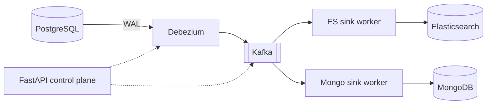

# Deltaflow

Real-time **change data capture** from PostgreSQL. Every insert, update and delete is read
from the database's write-ahead log, streamed through Kafka, and delivered to
**Elasticsearch** (search) and **MongoDB** (analytics), correctly, even when workers crash
or events are replayed.

[](https://github.com/Amitreddy14/deltaflow/actions/workflows/ci.yml)

> **Status:** Phase 0 (foundation). See the [roadmap](docs/ROADMAP.md).

## Architecture



Key properties: per-row ordering (messages keyed by primary key), at-least-once delivery with
**LSN-guarded idempotent sinks** (replays are harmless), dead-letter topics, and independent
consumer groups per sink. Full detail in the [design document](docs/DESIGN.md) and the
[ADRs](docs/adr/).

## Tech stack

PostgreSQL 16 · Debezium 2.7 on Kafka Connect · Apache Kafka 3.8 (KRaft) · Elasticsearch 8 ·
MongoDB 7 · Python 3.12 · FastAPI · Docker Compose · GitHub Actions

## Quick start

Requires Docker Desktop (about 4 GB of free memory) and Python 3.11+.

```bash
git clone https://github.com/Amitreddy14/deltaflow.git
cd deltaflow
cp .env.example .env            # Windows PowerShell: Copy-Item .env.example .env

docker compose up -d --wait     # starts and waits until every service is healthy
curl http://localhost:8000/health
```

Optional Kafka browser UI: `docker compose --profile tools up -d` then open http://localhost:8080.

Stop everything: `docker compose down` (add `-v` to also delete data volumes).

## Development

```bash
python -m venv .venv
.venv\Scripts\Activate.ps1      # macOS/Linux: source .venv/bin/activate
pip install -e ".[dev]"

ruff check . && ruff format --check . && mypy && pytest
uvicorn deltaflow.api.main:app --reload
```

## Project layout

```
src/deltaflow/      application package (API now; sink workers from Phase 2)
tests/              unit tests (integration tests from Phase 2 onward)
docs/               design document, ADRs, roadmap
docker-compose.yml  local stack: Postgres, Kafka, Debezium, Elasticsearch, MongoDB, API
.github/            CI workflow, PR template, Dependabot
```

## License

MIT
