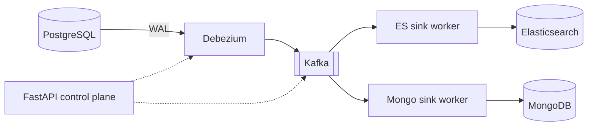

# Deltaflow

Real-time **change data capture** from PostgreSQL. Every insert, update and delete is read
from the database's write-ahead log, streamed through Kafka, and delivered to
**Elasticsearch** (search) and **MongoDB** (analytics), correctly, even when workers crash
or events are replayed.

[](https://github.com/Amitreddy14/deltaflow/actions/workflows/ci.yml)

> **Status: v1.0, all phases complete.** Production deploy files, a deployment guide for a free
> cloud VM, and a crash test that ends in `PASS`. Not yet deployed to a real cloud account; the
> [guide](docs/deployment.md) says exactly what is and is not verified.

## What makes it more than a demo

- **Correct under failure, and it proves it.** `deltaflow chaos` SIGKILLs both sink workers and
  restarts Debezium while the database is changing, then compares every row in Postgres,
  Elasticsearch and MongoDB. A green run ends in `PASS`; CI runs it on every pull request.
- **Idempotent by construction.** Each write carries the change's WAL position (LSN) and sinks
  ignore anything older than what they hold, so replays and redeliveries are harmless.
- **Bad data does not stop the line.** Poison events are bisected out of a batch and parked on a
  dead-letter topic with the reason; transient outages are retried, never dead-lettered.
- **Operable.** HTTP control plane (readiness, lag, dead letters, connector control, Prometheus),
  heartbeat-based health checks, clean shutdown that never loses a committed batch.
- **Deployable.** One command generates secrets; one compose file runs it behind automatic HTTPS
  with every datastore closed to the internet. The security model, including its limits, is in
  [SECURITY.md](SECURITY.md).

## Architecture



A hardened variant of the same stack (HTTPS front door, authenticated datastores, nothing but
Caddy reachable from outside) is in [docs/deployment.md](docs/deployment.md).

Key properties: per-row ordering (messages keyed by primary key), at-least-once delivery with
**LSN-guarded idempotent sinks** (replays are harmless), dead-letter topics, and independent
consumer groups per sink. Full detail in the [design document](docs/DESIGN.md) and the
[ADRs](docs/adr/).

## Tech stack

PostgreSQL 16 · Debezium 2.7 on Kafka Connect · Apache Kafka 3.8 (KRaft) · Elasticsearch 8 ·
MongoDB 7 · Python 3.12 · FastAPI · Docker Compose · GitHub Actions

## Quick start

Requires Docker Desktop (about 4 GB of free memory) and Python 3.11+.

```bash
git clone https://github.com/Amitreddy14/deltaflow.git
cd deltaflow
cp .env.example .env            # Windows PowerShell: Copy-Item .env.example .env

docker compose up -d --wait     # starts and waits until every service is healthy
curl http://localhost:8000/health
```

### Watch changes flow (Phase 1)

```bash
pip install -e ".[dev]"
deltaflow register-connector                    # Debezium starts streaming Postgres changes
deltaflow tail deltaflow.public.orders          # terminal 1: live events
deltaflow loadgen --rate 5 --duration 30        # terminal 2: random inserts, updates, deletes
```

Details, expected output and troubleshooting: [docs/phase-1-capture.md](docs/phase-1-capture.md).
If you ran the stack before Phase 1, reset it once with `docker compose down -v`.

### Search the data in Elasticsearch (Phase 2)

```bash
docker compose up -d --wait --build          # also starts the es-sink worker
deltaflow search customers "Reddy"
deltaflow search orders "status:shipped"
```

Details, failure demos (stop the sink, replay all history) and troubleshooting:
[docs/phase-2-es-sink.md](docs/phase-2-es-sink.md).

### Analytics in MongoDB and cross-store check (Phase 3)

```bash
pip install -e ".[dev]"                      # adds pymongo
docker compose up -d --wait --build          # also starts the mongo-sink worker
deltaflow loadgen --rate 5 --duration 30
deltaflow verify --wait 30                   # Postgres == Elasticsearch == MongoDB
deltaflow analytics transitions
```

Collections, reports, failure demos and troubleshooting:
[docs/phase-3-mongo-sink.md](docs/phase-3-mongo-sink.md).

### Reliability: dead letters, TRUNCATE, clean shutdown (Phase 4)

```bash
docker compose up -d --wait --build
deltaflow register-connector      # re-apply so TRUNCATE is captured
deltaflow dlq show es             # quarantined events, with the reason
deltaflow dlq replay es           # re-publish them once the cause is fixed
```

Demos (poison message, truncate and restore, graceful stop) and troubleshooting:
[docs/phase-4-reliability.md](docs/phase-4-reliability.md).

### Control plane (Phase 5)

```bash
curl http://127.0.0.1:8000/ready       # dependencies reachable? (503 if not)
curl http://127.0.0.1:8000/pipeline    # healthy or degraded, and why
curl http://127.0.0.1:8000/lag         # how far behind each sink is
curl http://127.0.0.1:8000/metrics     # Prometheus
```

Endpoints, demos, API key protection and metrics: [docs/phase-5-control-plane.md](docs/phase-5-control-plane.md).
Interactive API docs at `/docs` (development; disabled in production mode).

### Proof: crash it, then compare every row (Phase 6)

```bash
deltaflow chaos            # SIGKILL both sinks, restart Debezium, under load -> PASS or FAIL
deltaflow verify --deep    # row-by-row comparison of Postgres, Elasticsearch and MongoDB
deltaflow bench            # latency and throughput; prints a Markdown table
```

Details, what the proof does and does not cover, and CI: [docs/phase-6-proof.md](docs/phase-6-proof.md).

#### Benchmarks

Measured with `deltaflow bench` on one machine, a single Kafka broker and one worker per sink.
They describe that setup, not a general limit.

Run on a developer laptop under Docker Desktop (hardware details: _add CPU / RAM here_):

| Measure | Elasticsearch | MongoDB |
|---|---|---|
| Latency, one change, p50 | 905 ms | 618 ms |
| Latency, p95 | 1303 ms | 1495 ms |
| Latency, p99 | 1321 ms | 1512 ms |
| Throughput, 5,000 rows, end to end | about 4,890 rows/s | about 4,870 rows/s |

Postgres accepted the 5,000 rows at about 29,000 rows/s, so the pipeline, not the source, is the
limit. The throughput figure is a lower bound for a drain that took about one second; a larger
run (`deltaflow bench --rows 50000`) gives a steadier number. Most of the latency is probably
Debezium's poll interval and the sinks' batching (not yet profiled).

### Deploy it (Phase 7)

```bash
deltaflow gen-env --domain <your-host> --email <you@example.com>   # writes .env.prod, secrets
docker compose -f docker-compose.prod.yml --env-file .env.prod up -d --wait
```

Step-by-step for a free Oracle Cloud VM (account, firewall, HTTPS, backups, upgrades, recovery):
[docs/deployment.md](docs/deployment.md). Security model: [SECURITY.md](SECURITY.md).

Optional Kafka browser UI: `docker compose --profile tools up -d` then open http://localhost:8080.

Stop everything: `docker compose down` (add `-v` to also delete data volumes).

## Development

```bash
python -m venv .venv
.venv\Scripts\Activate.ps1      # macOS/Linux: source .venv/bin/activate
pip install -e ".[dev]"

ruff check . && ruff format --check . && mypy && pytest
uvicorn deltaflow.api.main:app --reload
```

## Project layout

```
src/deltaflow/        application package
  events.py sinks/    change-event model; Elasticsearch and MongoDB sinks
  worker.py runners.py  consumer loop, retries, dead letters, shutdown
  api/ ops.py         FastAPI control plane and the operations facade
  chaos.py proof.py bench.py verify.py   the correctness proof and benchmarks
  clients.py envgen.py  datastore clients with auth; production secret generation
infra/                Postgres init SQL, Debezium connector, Caddy and Prometheus configs
deploy/               backup script
tests/                unit tests, plus tests/integration (needs the compose stack)
docs/                 design, ADRs, roadmap, per-phase guides, deployment guide
docker-compose.yml        local stack
docker-compose.prod.yml   production stack (HTTPS, auth, private network)
.github/              CI (lint, types, tests, full-stack chaos) and the release workflow
```

Further reading: [design](docs/DESIGN.md), [ADRs](docs/adr/), [roadmap](docs/ROADMAP.md),
[changelog](CHANGELOG.md), [contributing](CONTRIBUTING.md).

## License

MIT
