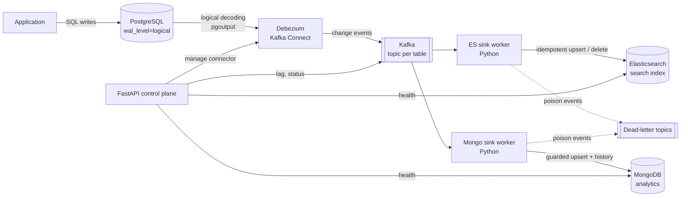

# Deltaflow: Design Document

Status: Phase 0 (accepted) · Owner: Amit Reddy

## 1. Problem

Applications write to a transactional database (PostgreSQL), but search and analytics
need the same data somewhere else, in a shape that suits them. Dual writes from the
application are fragile: one write succeeds, the other fails, and the stores drift apart.

Deltaflow solves this with **change data capture (CDC)**. It reads the database's own
write-ahead log (WAL), so every committed insert, update and delete is observed exactly
as the database saw it, and streams those changes to downstream stores.

## 2. Goals and non-goals

**Goals**

- Capture inserts, updates and deletes from PostgreSQL in near real time, with no changes to application code.
- Deliver them to **Elasticsearch** (search index) and **MongoDB** (analytics store).
- Correct under failure: sink crashes, redeliveries, restarts and out-of-order retries must never leave a sink with stale data over fresh data.
- Operable: health, consumer lag, dead-letter handling and a replay/backfill path.
- Reproducible: one `docker compose up` for development, free-tier deployable files for production.

**Non-goals**

- Multi-region Kafka, exactly-once across heterogeneous sinks (we achieve effectively-once through idempotency, see section 6).
- Cross-table joins or denormalisation in flight (a later extension).
- Replacing a managed CDC product. This is an engineering build, not a SaaS.

## 3. Architecture

| Component | Role |
|---|---|
| PostgreSQL 16 | Source of truth. Logical replication enabled; a replication slot and publication are owned by the connector. |
| Debezium (Kafka Connect) | Reads the WAL, runs the initial snapshot, emits one event per row change. |
| Kafka (KRaft, no ZooKeeper) | Durable, ordered log. One topic per table; the row's primary key is the message key. |
| Python sink workers | Consume topics, transform events and write to a sink. Each sink is an independent consumer group, so one slow sink never blocks the other. |
| Elasticsearch | Search index holding current row state. |
| MongoDB | Analytics store holding current state plus an append-only change history. |
| FastAPI | Control plane: connector registration, pipeline status, lag, health. |

## 4. Event model

Debezium emits an envelope per change. Deltaflow normalises it into an internal `ChangeEvent`:

| Field | Meaning |
|---|---|
| `op` | `c` create, `u` update, `d` delete, `r` snapshot read |
| `table` | `schema.table` the change came from |
| `key` | Primary key of the row (also the Kafka message key) |
| `before` / `after` | Row image before and after the change (`after` is null for deletes) |
| `lsn` | PostgreSQL log sequence number of the change. This is our **version**. |
| `ts_ms` | Commit timestamp from the source |

The `lsn` is monotonic per source database, so it gives every change a total order. All
idempotency decisions in section 6 are built on it.

## 5. Ordering

Kafka guarantees order only within a partition. Keying every message by the row's
primary key sends all changes to one row to the same partition, so **per-row order is
preserved end to end**. There is deliberately no global order across rows, because none is
needed for current-state sinks and it would prevent parallelism.

## 6. Delivery semantics: at-least-once plus idempotent sinks

Workers commit Kafka offsets **only after** the sink acknowledges the write. A crash
between write and commit causes redelivery, never loss. Redelivery is harmless because
every sink write is guarded by the event's `lsn`:

- **Elasticsearch:** index with `version_type=external` and `version=lsn`. ES rejects any write whose version is not greater than the stored one, so a replayed or late event cannot overwrite newer data. Deletes use the same version.
- **MongoDB:** upsert filtered on `{_id: key, _lsn: {$lt: lsn}}`. A stale event matches nothing and is a no-op. The history collection uses `(table, key, lsn)` as a unique key, so replays insert nothing new.

Net result: effectively-once visible state, with simple and testable code.

## 7. Failure modes

| Failure | Behaviour |
|---|---|
| Sink worker crashes mid-batch | Uncommitted offsets are re-read on restart; the LSN guard makes re-application a no-op. |
| Elasticsearch or MongoDB down | Worker retries with exponential backoff and pauses consumption. Kafka retains events, so lag grows and then drains. |
| Poison event (cannot be transformed or is rejected permanently) | Published to a per-sink dead-letter topic with the error attached (the bad event is found by bisecting the batch); the partition keeps moving. Transient failures are retried, never dead-lettered. See ADR-0010. |
| Kafka Connect crashes | Connector offsets live in Kafka; Debezium resumes from its last committed LSN. The replication slot retains WAL meanwhile. |
| Connector stopped for a long time | The replication slot makes Postgres retain WAL, which can fill the disk. Mitigation: the production compose file sets `max_slot_wal_keep_size=5GB`, which protects the disk at the cost of invalidating the slot if the outage outlasts the cap (recovery: [deployment guide](deployment.md), ADR-0013). |
| Schema change on source | Debezium schema history picks up new columns; sinks tolerate additive changes (Elasticsearch dynamic mapping, schemaless Mongo). Breaking changes go to the dead-letter topic. |
| Sink needs rebuilding | Reset the sink consumer group offsets to earliest, or trigger a Debezium incremental snapshot. |

## 8. Security and configuration

- All secrets come from environment variables (`.env` is git-ignored; `.env.example` documents them).
- Local compose binds every port to `127.0.0.1`.
- The development stack runs Elasticsearch with security off. The production compose phase enables authentication and keeps data stores off public interfaces.
- The API container runs as a non-root user.

## 9. Testing strategy

- **Unit:** event normalisation, LSN guard logic and retry policy, all pure Python.
- **Integration (marked `integration`):** real Postgres, Kafka, Elasticsearch and MongoDB from compose; assert that insert, update and delete propagate, and that replays are idempotent.
- **Chaos demo:** kill a sink worker mid-stream, restart, and prove both sinks converge to the source with zero loss and zero duplicates. This is the headline demo.
- CI runs lint, type checks and unit tests on every PR; the integration suite runs against compose in CI from the phase that introduces it.

## 10. Phase plan

See [ROADMAP.md](ROADMAP.md).
