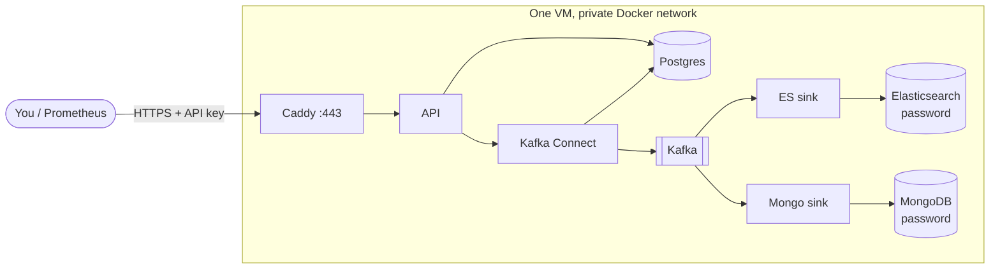

# Deployment guide: one free VM, HTTPS, no open datastore ports

This takes the production stack ([`docker-compose.prod.yml`](../docker-compose.prod.yml)) from
nothing to a public, authenticated control plane on **Oracle Cloud Always Free**. Any Ubuntu VM
with Docker works the same way from step 3 onwards.

> **Status, stated plainly:** these files are validated in CI (`docker compose config`, image
> build, unit tests for the auth and secret generation) but the stack has not yet been run on a
> real cloud VM. The first deployment is where arm64 behaviour of the Kafka and Debezium images
> and the exact Oracle console wording get confirmed. If a step here is wrong, fix this guide in
> the same PR as the fix.



Only Caddy listens on a public port. Everything else is reachable only from inside the Docker
network.

## What you need

| Item | Notes |
|---|---|
| Oracle Cloud account | Free, but signup asks for a credit card for identity checks. Pick your home region carefully; it cannot be changed. |
| A VM with **8 GB RAM or more** | The stack's memory limits add up to about 6 GB. Always Free allows up to 4 ARM cores and 24 GB in total; use 12 GB or more for headroom. |
| A hostname | Free option: `<ip-with-dashes>.sslip.io`, for IP `152.70.1.2` that is `152-70-1-2.sslip.io`. It resolves to your IP with no signup. A DuckDNS name also works. Let's Encrypt applies rate limits per registered domain, and sslip.io is shared by many people, so if certificate issuance is refused use DuckDNS. |
| A GitHub repo with Actions | To build and publish the image. |

## 1. Publish the image

The release workflow builds `linux/amd64` and `linux/arm64` images and pushes them to GitHub
Container Registry when you push a version tag:

```bash
git tag v1.0.0
git push origin v1.0.0
```

Wait for the **Release** workflow to go green. Then make the package pullable: GitHub, your
profile, **Packages**, `deltaflow`, **Package settings**, change visibility to **Public**. (To
keep it private instead, run `docker login ghcr.io` on the VM with a token that has
`read:packages`.)

## 2. Create the VM

1. Oracle console, **Compute**, **Instances**, **Create instance**.
2. Image: **Canonical Ubuntu 24.04** (or 22.04). Shape: **VM.Standard.A1.Flex**, 2 OCPUs and 12 GB
   or more.
3. Add your SSH public key. Create the instance and note its **public IP**.
4. If creation fails with **"Out of host capacity"**, that is common on the free ARM shape.
   Retry later, try a different availability domain, or start with fewer cores. It is not a
   problem with your configuration.

## 3. Open ports 80 and 443

Oracle blocks traffic in two places and you must open both.

**Cloud firewall.** Networking, your VCN, **Security Lists**, default list, **Add Ingress Rules**:

| Source CIDR | Protocol | Destination port |
|---|---|---|
| `0.0.0.0/0` | TCP | `80` |
| `0.0.0.0/0` | TCP | `443` |
| `0.0.0.0/0` | UDP | `443` |

Port 22 (SSH) is open by default. Narrowing its source to your own IP is a cheap, worthwhile
hardening step.

**The VM's own firewall.** Oracle's Ubuntu images ship iptables rules that reject new inbound
connections. If a port times out from outside even though the rule above exists, run on the VM:

```bash
sudo iptables -I INPUT 6 -m state --state NEW -p tcp --dport 80  -j ACCEPT
sudo iptables -I INPUT 6 -m state --state NEW -p tcp --dport 443 -j ACCEPT
sudo iptables -I INPUT 6 -m state --state NEW -p udp --dport 443 -j ACCEPT
sudo apt-get install -y iptables-persistent && sudo netfilter-persistent save
```

## 4. Install Docker and fetch the code

```bash
ssh ubuntu@<public-ip>

curl -fsSL https://get.docker.com | sudo sh
sudo usermod -aG docker "$USER" && exit      # log out and back in so the group applies
ssh ubuntu@<public-ip>

git clone https://github.com/Amitreddy14/deltaflow.git && cd deltaflow
git checkout v1.0.0
```

## 5. Generate the secrets

`deltaflow gen-env` writes `.env.prod` with random passwords and an API key. It runs from the
image you just published, so no Python install is needed:

```bash
IMAGE=ghcr.io/amitreddy14/deltaflow:1.0.0
docker run --rm --user "$(id -u):$(id -g)" -v "$PWD:/work" "$IMAGE" \
  deltaflow gen-env --dir /work --version 1.0.0 \
  --domain 152-70-1-2.sslip.io --email you@example.com
```

It refuses to overwrite existing files on purpose: regenerating a database password after the
database was initialised would lock the services out of their own data. To start over, delete
`.env.prod` and `secrets/` **and** the data volumes (`docker compose ... down -v`).

Your API key is the `DELTAFLOW_API_KEY` line in `.env.prod`. Copy it to your password manager,
and never commit `.env.prod` (it is git-ignored).

## 6. Start the stack

A shortcut for the long command, used in the rest of this guide:

```bash
alias dc='docker compose -f docker-compose.prod.yml --env-file .env.prod'
dc pull
dc up -d --wait
dc ps
```

`--wait` returns once every service reports healthy. The first start takes a few minutes
(Elasticsearch and Kafka are slow to warm up). Caddy requests the certificate on first contact;
if HTTPS does not work within a minute, `dc logs caddy` says why (usually a closed port 80 or a
hostname that does not resolve to the VM).

## 7. Register the connector and check it

```bash
export DOMAIN=152-70-1-2.sslip.io
export KEY=$(grep ^DELTAFLOW_API_KEY= .env.prod | cut -d= -f2)

curl -s https://$DOMAIN/health                                     # open: {"status":"ok",...}
curl -s -o /dev/null -w '%{http_code}\n' https://$DOMAIN/pipeline  # 401: protected
curl -s -X POST https://$DOMAIN/connector/register -H "X-API-Key: $KEY"     # register Debezium
curl -s https://$DOMAIN/pipeline -H "X-API-Key: $KEY"              # healthy, with reasons if not
dc exec api deltaflow verify --deep --wait 60                      # Postgres == ES == Mongo
```

If all five answer as shown, the demo dataset has flowed through the whole pipeline. To watch
live changes, generate load: `dc exec api deltaflow loadgen --rate 5 --duration 30`.

Optional metrics: `dc --profile monitoring up -d`, then from your laptop
`ssh -L 9090:127.0.0.1:9090 ubuntu@<ip>` and open http://127.0.0.1:9090.

## 8. Backups and restore

Postgres is the system of record. Elasticsearch and MongoDB are **derived** from it and can be
rebuilt, so only Postgres is backed up.

```bash
./deploy/backup.sh                # test it once by hand
crontab -e                        # then add the line below for a nightly run at 03:15
15 3 * * * cd /home/ubuntu/deltaflow && ./deploy/backup.sh >> backups/backup.log 2>&1
```

Backups land in `backups/` (git-ignored, owner-only) and the last 7 days are kept
(`KEEP_DAYS=14` changes that). Copy them off the VM too; a backup on the disk that dies is not a
backup. A plain `rsync` or `scp` to your laptop is enough to start.

**What a backup does not give you.** Kafka keeps change events for 3 days (or 2 GiB per
partition), so a sink that has been broken for longer than that cannot catch up by replay; it
must be rebuilt from Postgres (see the slot section below).

**Restore** (this replaces the database contents):

```bash
dc stop es-sink mongo-sink connect
gunzip -c backups/shop-<timestamp>.sql.gz | dc exec -T postgres sh -c \
  'psql -U "$POSTGRES_USER" -d "$POSTGRES_DB"'
```

After a restore the data no longer lines up with the Debezium replication slot, so follow
"Rebuilding after a lost slot" below before starting the connector again.

## 9. Operating it

| Task | Command |
|---|---|
| Status and lag | `curl -s https://$DOMAIN/pipeline -H "X-API-Key: $KEY"`, and `/lag`, `/dlq` |
| Pause or resume capture | `curl -X POST https://$DOMAIN/connector/pause` (or `/resume`, `/restart`) with the key |
| Logs | `dc logs -f --tail 100 es-sink` |
| Dead letters | `dc exec api deltaflow dlq show es` |
| Upgrade | edit `DELTAFLOW_VERSION` in `.env.prod`, then `dc pull && dc up -d --wait` |
| Roll back | set `DELTAFLOW_VERSION` to the previous tag and repeat the same two commands |
| Stop, keep data | `dc down` |
| Stop, **delete data** | `dc down -v` |

Schema note: the database schema is created from `infra/postgres/init` only on a fresh volume.
There is no migration tooling yet, so schema changes to an existing deployment are manual.

## 10. Disk safety and the replication slot

A Debezium connector holds a Postgres **replication slot**, and Postgres keeps WAL for the slot
until the connector reads it. If the connector is stopped for a long time the WAL would fill the
disk and take the database down. The production compose file caps this with
`max_slot_wal_keep_size=5GB`. The trade-off, chosen deliberately: Postgres survives, but if the
connector is down long enough to exceed the cap, **the slot is invalidated** and the connector
cannot resume.

Signs: `/pipeline` reports the connector `FAILED`, and `dc logs connect` mentions the slot. To
recover without losing correctness:

1. Stop the sinks and the connector: `dc stop es-sink mongo-sink`, then stop it inside Connect:
   `dc exec connect curl -s -X PUT localhost:8083/connectors/shop-postgres/stop`.
2. Drop the dead slot:
   `echo "SELECT pg_drop_replication_slot('deltaflow_slot');" | dc exec -T postgres sh -c 'psql -U "$POSTGRES_USER" -d "$POSTGRES_DB"'`.
3. Clear the connector's stored offsets so the next start takes a fresh snapshot:
   `dc exec connect curl -s -X DELETE localhost:8083/connectors/shop-postgres/offsets`.
   Then `dc start es-sink mongo-sink` and `curl -X POST https://$DOMAIN/connector/register -H "X-API-Key: $KEY"`
   to register and resume.
4. Rows deleted while capture was down are not repeated by a snapshot, so they may linger in
   Elasticsearch and MongoDB. Run `verify --deep`; if it reports extras, delete the derived
   indices and collections and let the snapshot repopulate them.

This procedure follows from how Debezium and the sinks work, but it has **not** been rehearsed
end to end. Rehearse it once on a throwaway deployment before you depend on it.

## Troubleshooting

| Symptom | Likely cause |
|---|---|
| `dc up` stops with `required variable ... is missing` | `.env.prod` is incomplete. This is intended: a missing secret must not become a blank password. Run `gen-env`. |
| Browser cannot connect on 443, or Caddy logs a certificate error | Port 80 or 443 closed in the security list or the VM's iptables (step 3), or the hostname does not point at the VM's IP. |
| `401` on everything | Missing key. Send `X-API-Key: <key>` or `Authorization: Bearer <key>`. |
| `/docs` returns 404 | Intended in production: interactive docs are disabled. |
| API container exits at start with "refusing to start" | `DELTAFLOW_AUTH_REQUIRED` is on without `DELTAFLOW_API_KEY`. Deliberate fail-closed behaviour. |
| Elasticsearch restarts in a loop | Not enough memory. Check `free -h`; give the VM more RAM or lower `ES_JAVA_OPTS` and `mem_limit`. |
| `exec format error` on a service | An image without an arm64 build. Check with `docker manifest inspect <image>`, and report it. |
| Connector stays `UNASSIGNED` for a minute | Normal right after Connect starts; recheck. If `FAILED`, read `dc logs connect`. |
| Oracle reclaims the instance | Always Free compute can be reclaimed if it sits idle. Check Oracle's current terms. This stack is not idle while it runs, but a stopped demo can be. |

See [SECURITY.md](../SECURITY.md) for what this setup protects against and what it does not.
